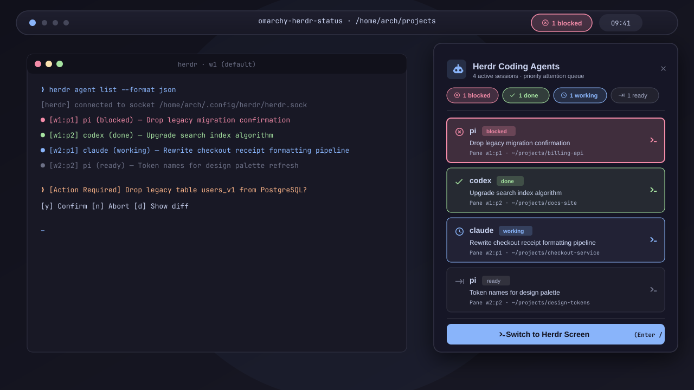

# omarchy-herdr-status

> Real-time status indicator on the Omarchy navigation bar for [Herdr](https://herdr.dev) AI coding agents, built on an event-driven Rust bridge with a tiny CPU and RAM footprint.




---

## Overview

When orchestrating multiple AI coding agents across Herdr workspaces and panes (such as `pi`, `claude`, `codex`, `gemini`, or subagent swarms), you need to know their state at a glance without having to switch terminal windows:
- Is an agent **working**?
- Is an agent **blocked** awaiting human confirmation or a permission prompt?
- Has a background turn **finished** (`done`)?

This project provides an event-driven status bar plugin for **Omarchy Linux** (Quickshell). It follows Herdr's live event stream over its UNIX domain socket and shows current agent activity directly on the desktop panel.

---

## Performance & Resource Consumption

The bridge subscribes to Herdr's per-pane status events instead of polling, and only re-checks a full snapshot every 30 s as a safety net.

Measured with Herdr 0.9.4 on an idle session (release build, 30 s window):

| Metric | Measured Value |
|---|---|
| **Wakeups while idle** | **8 per 30 s** (v1.2.4 polled: 132 per 30 s) |
| **CPU time while idle** | 0 ticks over 30 s |
| **RAM footprint (RSS)** | **~2.5 MB** |
| **Status latency** | **3–41 ms** from `herdr pane report-agent` to bridge output (v1.2.4: up to 1.5 s, and short states could be missed) |
| **Disk I/O** | One small write to `$XDG_RUNTIME_DIR` (tmpfs) per status change, for elapsed timers |

---

## Features

- **Priority Attention Queue**:
  - Sorts agents by urgency: `blocked` (needs human answer) > `done` (completed work) > `working` (busy) > `ready` (idle).
  - `blocked` cards are tinted with the theme's urgent color, `done` with the theme's green, while `working` and `ready` stay subdued. All colors follow the active Omarchy theme.
- **Elapsed Timers**:
  - Each card shows how long the agent has been in its current state (`needs input · 4m 02s`). Timers survive bridge restarts and shell reloads.
- **Keyboard-First Navigation** in the open panel:
  - `↑` / `↓` or `k` / `j`: Move selection across agent cards.
  - `Enter` or `o`: Focus the selected agent's pane and raise its terminal window.
  - `/` or `f`: Search agents by name, status, pane, title, directory or session.
  - `r`: Restart the bridge (forces a fresh snapshot).
  - `Escape`: Clear the search, or close the panel.
- **Status Filters**: Click a status pill (`working`, `needs input`, `done`, `ready`) to show only those agents; click again or the filter chip to clear.
- **Multi-Session Herdr Support**:
  - Watches the default session and every named session (`herdr --session <name>`) at the same time, picking up sessions that start or stop.
- **Interactive Controls**:
  - **Left-Click**: Toggles the summary panel with live agent cards.
  - **Right-Click**: Focuses the most urgent agent's pane and raises the terminal window running Herdr.
- **Desktop Notifications**: A notification when an agent goes from `working` to `needs input` or `done`; clicking it jumps to the pane.
- **Pi / OMP Needs-Input Detection**: Herdr reports Pi agents as `idle` while they wait on a question. The bridge reads the tail of the agent's session transcript (`~/.pi/agent/sessions/…`) and shows the agent as `needs input` when an interactive tool call (`ask`, `goal_question`, …) is unanswered, or when the last assistant message ends with a question.
- **Live Status Badges**:
  - `󰅚 <N> blocked`: An agent is waiting on approval or input.
  - `󰄬 <N> done`: A turn finished while you were looking elsewhere.
  - `󱑎 <N> working`: A turn is active.
  - `󰌒 <N> ready`: Agents are idle and ready for a prompt.
  - `󰚩 off`: No Herdr server is running.

---

## Configuration

Widget settings are extra keys on the widget's entry in `~/.config/omarchy/shell.json`:

```json
{ "id": "arch.herdr-status", "notificationsEnabled": true, "detectExternalAgents": false }
```

| Setting | Default | Description |
|---|---|---|
| `notificationsEnabled` | `true` | Desktop notification when an agent goes from working to needs input / done. |
| `detectExternalAgents` | `false` | Also list `claude`, `codex`, `opencode`, `gemini`, `pi` and `omp` processes running **outside** Herdr in an "Outside Herdr" section. Their state is unknown, so they are not counted in the badge. |

Environment variables:

| Variable | Used by | Description |
|---|---|---|
| `HERDR_SOCKET` | bridge | Watch only this socket instead of discovering all sessions. |
| `HERDR_STATUS_LOG` | bridge | Log diagnostics to stderr (same as `--verbose`). |
| `HERDR_FOCUS_CLASSES` | `herdr-focus` | Space-separated window classes to try when the Herdr window cannot be found by process (default: ghostty, Alacritty, foot, kitty, WezTerm). |

---

## Project Structure

```
omarchy-herdr-status/
├── manifest.json            # Omarchy shell plugin manifest
├── Cargo.toml               # Rust package configuration
├── src/
│   ├── main.rs              # CLI arguments and entry point
│   ├── monitor.rs           # One worker per Herdr session, merged output
│   ├── herdr.rs             # Socket discovery, snapshots, event subscription
│   ├── status.rs            # Status normalization and Pi/OMP refinement
│   ├── pi.rs                # Pi session transcript lookup and inspection
│   ├── timers.rs            # Persisted per-agent elapsed timers
│   ├── payload.rs           # JSON payload, summary and sorting
│   ├── standalone.rs        # Opt-in detection of agents outside Herdr
│   └── demo.rs              # Demo agents for --demo
├── plugin/
│   ├── HerdrStatus.qml      # Quickshell bar widget and panel
│   ├── StatusPill.qml       # Status count / filter pill
│   └── AgentCard.qml        # Agent row in the panel
├── scripts/
│   └── focus-herdr.sh       # Installed as herdr-focus: jump to a pane and its window
├── install.sh               # Build and install
├── uninstall.sh             # Provenance-checked removal
├── docs/plans/              # Design notes
├── preview.png              # Marketplace preview
├── LICENSE
└── README.md
```

---

## Installation

### Prerequisites
- Omarchy Linux with Hyprland and the Omarchy shell (Quickshell)
- Rust & Cargo (stable)
- Herdr 0.9.x (tested with 0.9.4, API protocol 22)
- `python3`, `jq` (used by the installer and `herdr-focus`; both ship with Omarchy)

### One-Command Setup
Clone the repository and run the installer:

```bash
git clone https://github.com/unrealandychan/omarchy-herdr-status.git
cd omarchy-herdr-status
./install.sh
```

The installer will:
1. Compile the optimized release binary (`herdr-status-bridge`).
2. Install it and the `herdr-focus` helper to `~/.local/bin/`.
3. Link the plugin into `~/.config/omarchy/plugins/arch.herdr-status`.
4. Register the widget in `~/.config/omarchy/shell.json`.
5. Restart the Omarchy shell so the new widget loads.

---

## Installer Scope

`install.sh` and `uninstall.sh` run entirely as your user, without privilege escalation or download tools; nothing is downloaded except the two exact-pinned crates (`serde`, `serde_json`) that `cargo build --locked` fetches from crates.io, verified against `Cargo.lock` checksums.

`install.sh` touches only these paths:

| Path | Change |
|---|---|
| `./target/` | `cargo build --locked --release` output inside the checkout |
| `~/.local/bin/herdr-status-bridge` | Installed binary; a different existing file is moved to `*.bak.<timestamp>`, never overwritten |
| `~/.local/bin/herdr-focus` | Installed helper (same backup rule) |
| `${XDG_STATE_HOME:-~/.local/state}/omarchy/arch.herdr-status/install-receipt.json` | SHA-256 of both installed files and the source path (directory `0700`, file `0600`) |
| `~/.config/omarchy/plugins/arch.herdr-status` | Symlink to the checkout; an existing different entry is moved to `*.bak.<timestamp>` |
| `~/.config/omarchy/shell.json` | Backed up, then `{"id": "arch.herdr-status"}` is added to the bar's right section if absent, using an atomic replace that refuses symlinks and files owned by another user |

It then runs `omarchy-shell shell rescanPlugins`, `omarchy plugin enable arch.herdr-status` (only if not already enabled) and `omarchy restart shell`.

`uninstall.sh` removes a binary, helper or symlink only when its SHA-256 matches the receipt or it points into this checkout, and removes the widget entry from `shell.json` (after a backup) only when this checkout owns the installation.

At runtime the bridge opens no network connections and starts no processes. It connects to Herdr's local sockets under `$XDG_CONFIG_HOME/herdr`, reads the tail of Pi session transcripts under `~/.pi/agent/sessions` (read-only), and writes one file: `$XDG_RUNTIME_DIR/herdr-status/state.json` (elapsed timers). With `--detect-external` it also reads `/proc` entries for your own processes. The widget runs `herdr-status-bridge`, `herdr-focus` (which calls `herdr`, `hyprctl`, `jq` and `omarchy-notification-send`) and `omarchy-notification-send`.

---

## Removal & Uninstallation

To completely remove Herdr Agent Status, run the uninstaller script:

```bash
./uninstall.sh
```

The uninstaller checks file identity and provenance against the installation receipt (`~/.local/state/omarchy/arch.herdr-status/install-receipt.json`) and the source checkout before unlinking or modifying any file, so foreign installations and user configuration stay untouched.

---

## Standalone Usage

The Rust bridge can also be used from the command line:

```bash
# Print one JSON snapshot of all agents across all sessions and exit
herdr-status-bridge --once

# Stream real-time status updates as newline-delimited JSON
herdr-status-bridge

# Demo data for screenshots (no Herdr connection, no real paths)
herdr-status-bridge --demo

# All options
herdr-status-bridge --help
```

| Option | Description |
|---|---|
| `--once` | Print a single snapshot and exit |
| `--demo` | Emit fixed demo agents |
| `--socket <PATH>` | Watch only this Herdr socket (also `HERDR_SOCKET`) |
| `--detect-external` | Also list agent processes running outside Herdr |
| `--verbose` | Log diagnostics to stderr (also `HERDR_STATUS_LOG=1`) |
| `-h`, `--help` / `-V`, `--version` | Help / version |

Example JSON output:
```json
{
  "connected": true,
  "agents": [
    {
      "name": "pi",
      "status": "blocked",
      "pane_id": "wD:p3",
      "workspace_id": "wD",
      "tab_id": "wD:t1",
      "title": "π - arch",
      "cwd": "/home/arch",
      "focused": true,
      "source": "herdr",
      "session": "default",
      "state_changed_at": 1792035504
    }
  ],
  "summary": {
    "total": 1,
    "working": 0,
    "blocked": 1,
    "done": 0,
    "idle": 0,
    "unknown": 0,
    "primary_status": "blocked",
    "badge_text": "󰅚 1 blocked",
    "badge_icon": "󰅚",
    "status_color": "urgent"
  }
}
```

- `status` is one of `working`, `blocked`, `done`, `idle`, `unknown`.
- `state_changed_at` is a Unix timestamp: when the bridge first saw the agent in its current status.
- `external_agents` (same shape, `status: "unknown"`) appears only with `--detect-external`.

---

## License

This project is licensed under the [MIT License](LICENSE).
